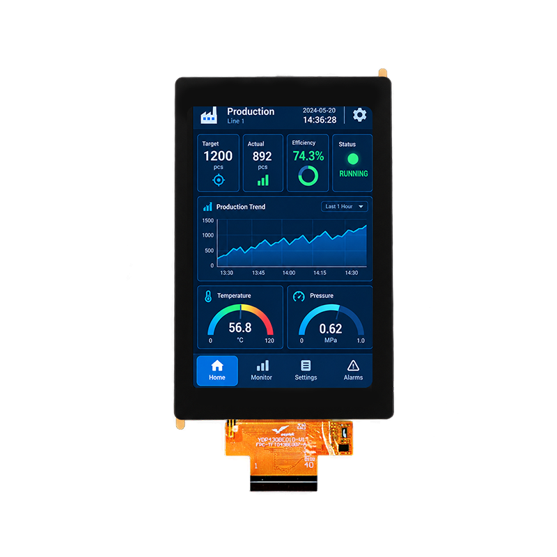

<p align="left"></p>

<h1 align="center">OSPTEK 4.3″ TFT Display 480×800 (YDP430BET010-V1)</h1>

<p align="center"><b>TFT module · RGB · ST7102</b></p>

<p align="center"><a href="./README.md">简体中文</a> | English · <a href="../../README_EN.md">Family index</a></p>

<p align="center">
  
  
  
</p>

<p align="center"></p>

## Contents

- [Specifications](#specifications)
- [Resources](#resources)
- [Repository layout](#repository-layout)
- [Buy](#buy)
- [Support](#support)

---

## Specifications

| Item | Spec |
| ---- | ---- |
| Size | 4.3 inch |
| Type | TFT |
| Resolution | 480×800 |
| Outline | 66.8 x 114.4 x 3.12 mm |
| Active area | 56.16 x 93.60 mm |
| Interface | RGB |
| Driver IC | ST7102 |
| Touch IC | ST7102 |

> Full outline, FPC definition, power, and timing follow the product datasheet / driver IC datasheet.

## Resources

| Category | File |
| ---- | ---- |
| Datasheet | [`ST7102_Datasheet_V0.1.pdf`](./datasheets/ST7102_Datasheet_V0.1.pdf) |
| Datasheet | [`YDP430BET010-V1.pdf`](./datasheets/YDP430BET010-V1.pdf) |
| CAD file | [`YDP430BET010-V1.dwg`](./cad/YDP430BET010-V1.dwg) |

## Repository layout

```text
display-tft-4.3inch-480x800/ # repo root (nav: ../../README_EN.md; sample projects under root examples/)
└── versions/
    └── YDP430BET010-V1/        # full materials for this part number
        ├── README.md
        ├── README_EN.md
        ├── osptek.yml
        ├── images/
        ├── datasheets/       # product datasheet + driver/touch IC datasheets
        └── cad/              # outline/cover CAD
```

## Buy

See the [repo home page](../../README_EN.md#where-to-buy).

## Support

See the [repo home page](../../README_EN.md#support).

---

<p align="center"><sub>© 2026 OSPTEK · Materials in this repository are licensed under CC BY 4.0</sub></p>
